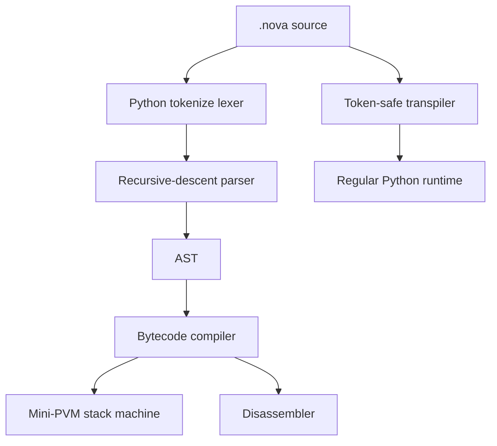

# CodeNest: custom-keyword Python + Mini-PVM

CodeNest is a small Python-like language with its own keywords, a stack-based bytecode
virtual machine, a disassembler, a token-safe transpiler, a REPL and a command-line tool.
Runtime code uses only the Python 3.8+ standard library.

## Architecture



## Install and run

```bash
python -m pip install -e .
codenest run examples/calculator.mypy
codenest dis examples/branching.mypy
codenest transpile examples/while_loop.mypy -o while_loop.py
codenest repl
```

## CodeNest keyword guide

| Python | CodeNest |
|---|---|
| if | check |
| elif | elsecheck |
| else | otherwise |
| while | repeat |
| for | foreach |
| in | within |
| print | show |
| True | yes |
| False | no |
| None | empty |
| and | both |
| or | either |
| not | invert |
| def | create |
| return | give |
| try | attempt |
| except | catch |
| break | stop |
| continue | skip |
| pass | nothing |

## Example

```python
score = 75
check score >= 40:
    show("Pass")
otherwise:
    show("Try again")
```

The Mini-PVM supports assignments, arithmetic, comparisons, conditional statements,
while loops, for loops over range, print statements and selected built-ins. The
transpiler changes only Python name tokens, preserving strings, comments and spacing.
CodeNest is an educational language subset, not a replacement for CPython.
